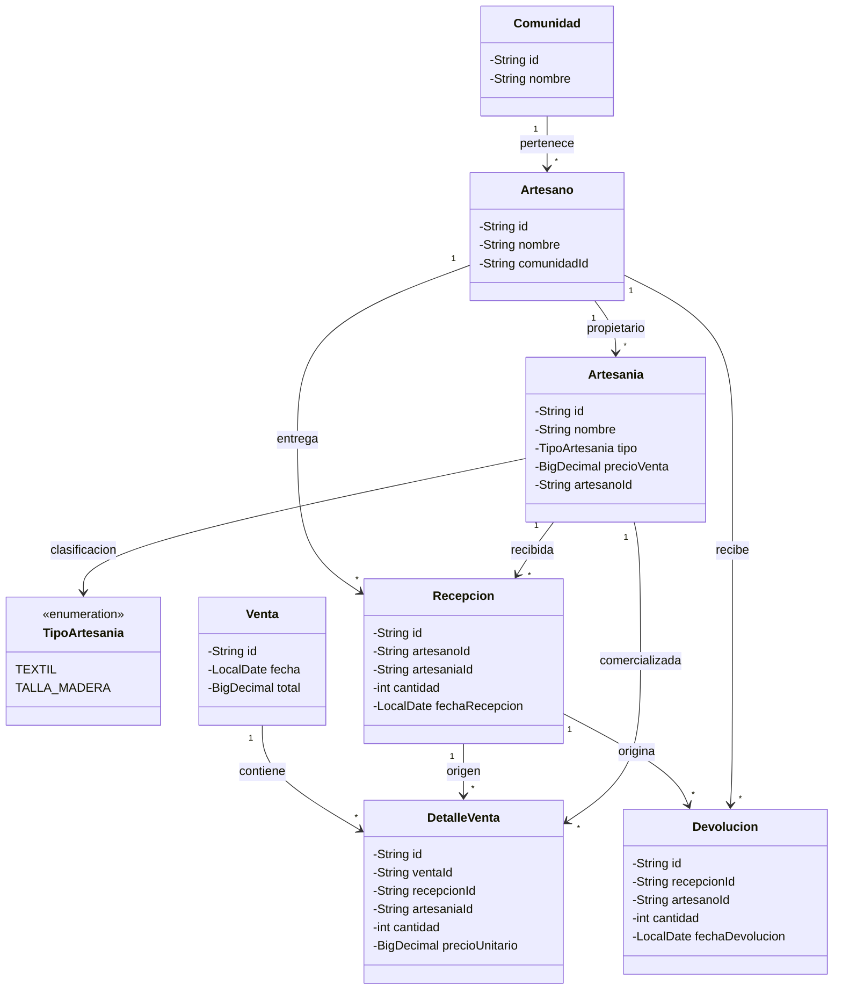

# trabajo1-bases-de-datos
Trabajo grupal de Bases de Datos: cinco sistemas desarrollados en Java utilizando programación orientada a objetos y almacenamiento JSON.

# Sistema de Consignación de Artesanías

Proyecto grupal de Bases de Datos desarrollado en Java, utilizando programación orientada a objetos (POO) y almacenamiento de información en archivos JSON.

## 1. Descripción

El sistema permite administrar la consignación y comercialización de artesanías elaboradas por artesanos pertenecientes a diferentes comunidades.

Permite registrar comunidades, artesanos, artesanías, recepciones, ventas y devoluciones. También permite consultar los registros y revisar las existencias del inventario.

La información se almacena en archivos JSON mediante el servicio de almacenamiento del proyecto.

## 2. Tecnologías utilizadas

- Java 17.
- Apache Maven.
- Gson para el almacenamiento JSON.
- JUnit 4 para pruebas automatizadas.
- Git y GitHub para el control de versiones.

## 3. Funcionalidades implementadas

El sistema cuenta con un menú principal con las siguientes opciones:

1. Registrar comunidad.
2. Registrar artesano.
3. Registrar artesanía.
4. Registrar recepción.
5. Registrar venta.
6. Registrar devolución.
7. Listar comunidades.
8. Listar artesanos.
9. Listar artesanías.
10. Listar recepciones.
11. Listar ventas.
12. Listar devoluciones.
13. Consultar inventario.
0. Salir del sistema.

## 4. Reglas de negocio

- Cada artesano pertenece a una comunidad.
- Cada artesanía está asociada a un artesano propietario.
- Las recepciones registran las artesanías entregadas en consignación.
- Las ventas se registran mediante detalles asociados a una recepción y una artesanía.
- Las devoluciones identifican la recepción y el artesano correspondiente.
- El sistema utiliza identificadores para relacionar las entidades.
- Las artesanías se clasifican mediante los tipos `TEXTIL` y `TALLA_MADERA`.

## 5. Estructura del proyecto

El proyecto está organizado en paquetes:

- `model`: contiene las entidades `Artesania`, `Artesano`, `Comunidad`, `DetalleVenta`, `Devolucion`, `Recepcion`, `TipoArtesania` y `Venta`.
- `service`: contiene los servicios para administrar las entidades, ventas, recepciones, devoluciones y almacenamiento JSON.
- `App.java`: contiene el menú principal y permite interactuar con el sistema.
- `src/test/java`: contiene las pruebas automatizadas.
- `data`: contiene los archivos JSON utilizados para almacenar los registros.

## 6. Requisitos para ejecutar el proyecto

Se necesita tener instalado:

- Java JDK 17.
- Apache Maven.
- Git, para clonar el repositorio.

## 7. Clonar y ejecutar el proyecto

Clonar el repositorio:

```bash
git clone https://github.com/MattyP200532/trabajo1-bases-de-datos.git
```

Ingresar a la carpeta del repositorio y luego a la carpeta del proyecto Maven:

```bash
cd trabajo1-bases-de-datos
cd trabajo1-bases-de-datos
```

Compilar el proyecto:

```bash
mvn clean compile
```

Ejecutar las pruebas automatizadas:

```bash
mvn clean test
```

Iniciar la aplicación:

```bash
mvn exec:java "-Dexec.mainClass=com.trabajo1.App"
```

**Importante:** los comandos Maven deben ejecutarse desde la carpeta que contiene el archivo `pom.xml`.

## 8. Pruebas

Se realizaron pruebas automatizadas utilizando JUnit 4.

Para ejecutar las pruebas:

```bash
mvn clean test
```

Resultado observado durante la verificación del proyecto:

```text
BUILD SUCCESS
```

También se realizaron pruebas manuales desde el menú principal para comprobar:

- Registro de comunidades.
- Registro de artesanos.
- Registro de artesanías.
- Registro de recepciones.
- Registro de ventas.
- Registro de devoluciones.
- Consulta de los registros.
- Consulta del inventario.

Las pruebas manuales permitieron comprobar el funcionamiento de las operaciones de registro y consulta. El cálculo del inventario requiere una verificación adicional.

## 9. Almacenamiento de información

El sistema utiliza archivos JSON dentro de la carpeta `data/`:

- `comunidades.json`: información de las comunidades.
- `artesanos.json`: información de los artesanos.
- `artesanias.json`: información de las artesanías.
- `recepciones.json`: registros de recepción.
- `ventas.json`: registros de ventas.
- `detalles-venta.json`: detalles de los productos vendidos.
- `devoluciones.json`: registros de devoluciones.

El servicio `JsonStorageService` administra la lectura y escritura de información mediante Gson.

## 10. Limitaciones

El proyecto es una implementación académica que utiliza archivos JSON para almacenar información. No utiliza una base de datos relacional ni cuenta con una interfaz gráfica o plataforma web.

## 11. Diagrama de clases UML

El siguiente diagrama representa las principales clases del sistema, sus atributos y las relaciones entre ellas.



## 12. Repositorio GitHub

**Repositorio:**  
https://github.com/MattyP200532/trabajo1-bases-de-datos

**Rama de desarrollo:**  
`feature/artesanias`
