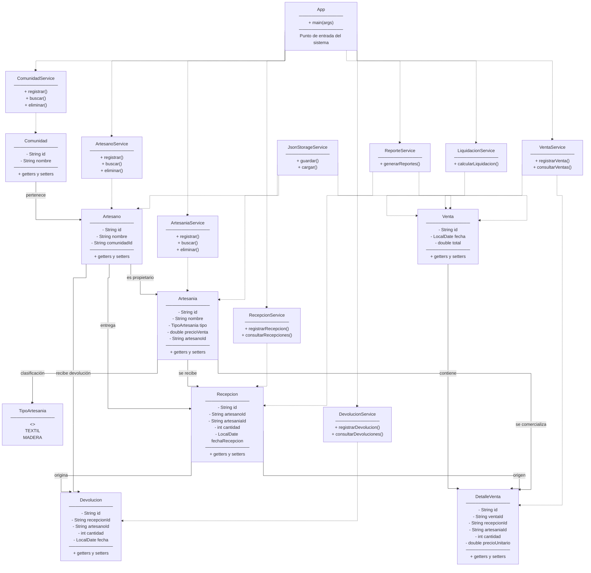

# trabajo1-bases-de-datos
Trabajo grupal de Bases de Datos: cinco sistemas desarrollados en Java utilizando programación orientada a objetos y almacenamiento JSON.

# Sistema de Consignación de Artesanías

## 1. Descripción

Sistema desarrollado en Java mediante programación orientada a objetos para administrar la consignación y comercialización de artesanías elaboradas por artesanos de diferentes comunidades. Permite registrar artesanos, comunidades y artesanías, controlar la recepción de productos, registrar ventas y devoluciones, calcular liquidaciones y generar reportes.

La información se guarda en archivos JSON y se recupera mediante el servicio de almacenamiento del sistema.

## 2. Tecnologías utilizadas

- Java 17 como versión de compilación.
- Maven para organizar y compilar el proyecto.
- Gson para guardar y recuperar información en archivos JSON.
- JUnit 4 para las pruebas automatizadas.
- Git y GitHub para el control de versiones.

## 3. Funcionalidades

- Registro y consulta de artesanos.
- Registro y consulta de comunidades.
- Registro y administración de artesanías.
- Recepción de artesanías entregadas por los artesanos en consignación.
- Registro de ventas y sus respectivos detalles.
- Registro de devoluciones de productos a sus propietarios.
- Control de cantidades recibidas, vendidas, devueltas y disponibles.
- Cálculo de liquidaciones para los artesanos según los productos vendidos.
- Aplicación de comisiones según el tipo de artesanía.
- Identificación de artesanías que llevan más de 90 días en tienda.
- Generación de reportes de ventas, liquidaciones y existencias.
- Almacenamiento y recuperación de información mediante archivos JSON.

## 4. Reglas de negocio

- Cada artesano pertenece a una comunidad.
- Cada artesanía está asociada a un artesano propietario.
- Las artesanías se reciben mediante registros de recepción que identifican el producto, el artesano, la cantidad y la fecha.
- Solo se paga al artesano por las unidades que hayan sido vendidas.
- Las artesanías textiles tienen una comisión del 20 %.
- Las artesanías de tallado en madera tienen una comisión del 25 %.
- Las artesanías que permanecen en tienda durante más de 90 días deben identificarse para su devolución.
- No se permite vender una cantidad superior a las unidades disponibles.
- No se permite devolver una cantidad superior a las unidades disponibles.
- Las devoluciones deben realizarse al artesano propietario de las artesanías.
- No se permite eliminar artesanos que tengan artesanías asociadas.
- No se permite eliminar artesanías que tengan movimientos registrados.

## 5. Estructura del sistema

- `model`: contiene las entidades `Artesania`, `Artesano`, `Comunidad`, `DetalleVenta`, `Devolucion`, `Recepcion`, `TipoArtesania` y `Venta`.
- `service`: contiene los servicios `ArtesaniaService`, `ArtesanoService`, `ComunidadService`, `DevolucionService`, `JsonStorageService`, `LiquidacionService`, `RecepcionService`, `ReporteService` y `VentaService`.
- `App.java`: contiene el punto de entrada de la aplicación.
- `src/test/java`: contiene las pruebas automatizadas de los servicios del sistema.
- `data`: contiene los archivos JSON utilizados para almacenar la información.

## 6. Ejecución

Se necesita tener instalado Java JDK 17 y Maven. Los comandos deben ejecutarse desde la carpeta que contiene el archivo `pom.xml`.

**Compilar el proyecto:**

```powershell
mvn clean compile
```

**Ejecutar todas las pruebas:**

```powershell
mvn clean test
```

**Iniciar la aplicación:**

```powershell
mvn exec:java "-Dexec.mainClass=com.trabajo1.App"
```

Para ejecutar una prueba específica en PowerShell:

```powershell
mvn "-Dtest=VentaServiceTest" test
mvn "-Dtest=RecepcionServiceTest" test
mvn "-Dtest=DevolucionServiceTest" test
```

La aplicación utiliza `App.java` como punto de entrada. Las operaciones disponibles dependen de las opciones implementadas en la aplicación.

## 7. Reportes disponibles

1. **Liquidación por artesano:** muestra las unidades vendidas durante un período, el total de ventas, la comisión correspondiente y el valor que debe recibir el artesano.
2. **Artesanías pendientes de devolución:** identifica los productos que llevan más de 90 días en tienda.
3. **Comunidades con mayores ventas:** permite identificar las comunidades que registran los mayores valores de comercialización.
4. **Artesanías más vendidas:** presenta los productos con mayor cantidad de unidades vendidas.
5. **Auditoría de existencias:** permite revisar las cantidades recibidas, vendidas, devueltas y disponibles para detectar inconsistencias.

## 8. Pruebas

Se añadieron pruebas automatizadas con JUnit 4 para comprobar el funcionamiento de los principales servicios del sistema:

- `DevolucionServiceTest`: comprueba las operaciones y validaciones relacionadas con las devoluciones.
- `JsonStorageServiceTest`: comprueba el almacenamiento y recuperación de información JSON.
- `LiquidacionServiceTest`: comprueba el cálculo de las liquidaciones de los artesanos.
- `RecepcionServiceTest`: comprueba el registro y las validaciones de las recepciones.
- `VentaServiceTest`: comprueba el registro y las validaciones de las ventas.

**Resultado observado durante las pruebas del proyecto:**

```text
Tests run: 15, Failures: 0, Errors: 0, Skipped: 0
BUILD SUCCESS
```

Este resultado corresponde a la ejecución realizada durante el desarrollo. Se puede repetir con el comando `mvn clean test`.

## 9. Almacenamiento

El sistema utiliza archivos JSON dentro de la carpeta `data/`:

- `artesanos.json`: almacena la información de los artesanos.
- `comunidades.json`: almacena la información de las comunidades.
- `artesanias.json`: almacena los datos de las artesanías y sus propietarios.
- `recepciones.json`: registra las entregas de artesanías en consignación.
- `ventas.json`: almacena los registros de ventas.
- `detalles-venta.json`: almacena los productos, cantidades y precios correspondientes a cada venta.
- `devoluciones.json`: registra las devoluciones realizadas.

El servicio `JsonStorageService` se encarga de gestionar la lectura y escritura de los archivos JSON mediante Gson.

## 10. Limitaciones

Este proyecto es una implementación académica que utiliza archivos JSON como mecanismo de almacenamiento. No utiliza una base de datos relacional ni cuenta con una interfaz gráfica o una plataforma web.

Para una implementación en un entorno real sería conveniente incorporar una base de datos, autenticación de usuarios, control de permisos, respaldos automáticos y mecanismos de protección ante modificaciones simultáneas de la información.

## 11. Diagrama de clases UML

El siguiente diagrama representa las principales clases del sistema, sus atributos, métodos y relaciones.



El diagrama se encuentra integrado en este README y GitHub lo representa automáticamente mediante Mermaid.