# Sistema de Gestión de Cafetería UTN

**Trabajo 1 de Bases de Datos – Universidad Técnica del Norte**  
**Rama de desarrollo:** `feature/cafeteria`  
**Repositorio grupal:** [trabajo1-bases-datos](https://github.com/MattyP200532/trabajo1-bases-datos)

Este README documenta el **Ejercicio 4: Sistema de Gestión de Cafetería UTN**. Describe sus funcionalidades, reglas de negocio, estructura, ejecución, reportes, pruebas realizadas, almacenamiento y diagrama de clases UML.

## 1. Descripción

Sistema desarrollado en Java mediante programación orientada a objetos para administrar los ingredientes, platos, recetas, bebidas, abastecimientos, ventas y movimientos de inventario de una cafetería universitaria.

La aplicación funciona mediante un menú interactivo en consola. Permite registrar y consultar información, controlar las existencias de ingredientes y bebidas, calcular el costo de preparación de los platos, registrar ventas y generar cinco reportes para apoyar el control de la cafetería.

La información se almacena en archivos JSON dentro de `data/cafeteria/`. Los repositorios cargan los datos al utilizar cada módulo y guardan los cambios cuando se realizan operaciones de registro o actualización. Por ello, los datos permanecen disponibles después de cerrar y volver a ejecutar el programa.

## 2. Tecnologías utilizadas

- **Java 17:** versión de lenguaje configurada en Maven mediante `maven.compiler.source` y `maven.compiler.target`.
- **Maven:** administración del proyecto, compilación y ejecución de pruebas.
- **Gson 2.13.2:** serialización y deserialización de objetos Java en archivos JSON.
- **JUnit Jupiter 5.11.4:** framework configurado para las pruebas automatizadas.
- **Git y GitHub:** control de versiones y trabajo colaborativo.
- **BigDecimal:** manejo de cantidades y valores monetarios que requieren precisión decimal.

La ejecución comprobada durante el desarrollo se realizó en Windows 11 con Java 21.0.10 y Maven 3.10.0. El proyecto mantiene configurada la compilación con compatibilidad de Java 17.

## 3. Funcionalidades implementadas

- Registro y consulta de ingredientes.
- Registro y consulta de platos.
- Registro, consulta y desactivación de bebidas.
- Registro y consulta de recetas asociadas a los platos.
- Registro y consulta de abastecimientos de ingredientes.
- Actualización del stock de ingredientes al registrar un abastecimiento.
- Registro y consulta de ventas de platos.
- Validación del inventario antes de registrar una venta de platos y descuento de los ingredientes utilizados.
- Registro y consulta de ventas de bebidas.
- Cálculo del precio de las bebidas con IVA del 15 %.
- Descuento del stock de bebidas después de registrar una venta válida.
- Registro y consulta de movimientos de inventario de ingredientes.
- Búsqueda del historial de movimientos por ingrediente.
- Generación de cinco reportes de cafetería.
- Persistencia de la información mediante archivos JSON.

## 4. Reglas de negocio

- Los identificadores de ingredientes, platos, recetas, bebidas, abastecimientos y ventas deben ser positivos.
- El nombre del ingrediente y de la bebida es obligatorio.
- Los ingredientes utilizan las unidades de medida `KILOGRAMO` o `LITRO`.
- El stock actual, el stock mínimo y el costo unitario de un ingrediente no pueden ser negativos.
- Una receta debe tener un identificador válido, estar asociada a un plato y contener al menos un detalle.
- Cada detalle de receta debe referenciar un ingrediente existente y tener una cantidad necesaria mayor que cero.
- Un plato no puede tener más de una receta registrada. Dentro de una receta no se permite agregar dos veces el mismo ingrediente.
- El costo de preparación de un plato se obtiene sumando el costo unitario de cada ingrediente multiplicado por la cantidad requerida en la receta.
- El precio de venta de un plato se calcula como el doble del costo de su receta. El margen mostrado corresponde al precio menos el costo.
- Para registrar un abastecimiento, el ingrediente debe existir y estar activo. La cantidad y el costo unitario deben ser mayores que cero y la fecha es obligatoria.
- Un abastecimiento aumenta el stock del ingrediente, actualiza su costo unitario y genera un movimiento de tipo `ABASTECIMIENTO`.
- Para vender platos, estos deben existir y estar activos, tener una receta con ingredientes válidos y solicitarse cantidades mayores que cero.
- Antes de descontar ingredientes por una venta de platos, el servicio calcula el consumo total requerido y comprueba que exista stock suficiente. Si algún ingrediente no alcanza, la venta se rechaza sin realizar el descuento de inventario.
- Una venta de platos descuenta las cantidades definidas en las recetas y genera movimientos de tipo `VENTA_PLATO` por ingrediente consumido.
- Las bebidas deben tener nombre, identificador positivo, stock no negativo y precio fijo mayor que cero.
- Para vender bebidas, estas deben estar activas y tener stock suficiente. La cantidad vendida debe ser mayor que cero.
- El IVA aplicado a las bebidas es del **15 %**. El precio con IVA se redondea a dos decimales.
- Los ingredientes con stock bajo son aquellos cuyo stock actual es estrictamente menor que el stock mínimo.
- El reporte de platos más vendidos recibe una fecha inicial y una fecha final; considera las ventas incluidas dentro de ese intervalo.
- Los registros de movimientos conservan la fecha, el ingrediente, el tipo, la cantidad y la descripción de la operación.

## 5. Estructura del sistema

En el repositorio grupal, el proyecto Maven de Cafetería se encuentra dentro de la carpeta `trabajo1-bases-de-datos/`. Esta carpeta contiene el `pom.xml`, el código fuente y los datos del ejercicio.

```text
trabajo1-bases-de-datos/
├── pom.xml
├── data/
│   └── cafeteria/
│       ├── ingredientes.json
│       ├── platos.json
│       ├── recetas.json
│       ├── bebidas.json
│       ├── abastecimientos.json
│       ├── ventas_platos.json
│       ├── ventas_bebidas.json
│       └── movimientos_inventario.json
└── src/
    ├── main/
    │   └── java/
    │       └── com/trabajo1/
    │           ├── App.java
    │           └── cafeteria/
    │               ├── controller/
    │               ├── model/
    │               ├── repository/
    │               └── service/
    └── test/
        └── java/com/trabajo1/
            └── AppTest.java
```

**Descripción de los paquetes y componentes:**

- `com.trabajo1.App`: contiene el método `main` y el menú principal de Cafetería UTN.
- `cafeteria.model`: contiene las entidades del sistema, como `Ingrediente`, `Plato`, `Receta`, `DetalleReceta`, `Bebida`, `Abastecimiento`, `VentaPlatos`, `VentaBebidas` y `MovimientoInventario`, además de los enumerados `UnidadMedida` y `TipoMovimiento`.
- `cafeteria.controller`: contiene los controladores que reciben las opciones y datos ingresados por consola y coordinan las operaciones.
- `cafeteria.service`: contiene las reglas de negocio, validaciones, cálculos de costos, ventas, abastecimientos y generación de reportes. Los reportes se implementan en `ReporteCafeteriaService` y se muestran mediante `ReporteController`.
- `cafeteria.repository`: contiene los repositorios encargados de consultar y guardar las entidades en JSON. `JsonDataManager` centraliza parte de la lectura y escritura; algunos repositorios utilizan Gson directamente.
- `src/test/java/com/trabajo1`: contiene las pruebas automatizadas configuradas con JUnit Jupiter.

## 6. Instrucciones de ejecución

Se necesita tener instalado un JDK 17 o superior y Maven. En el repositorio grupal, primero se debe ingresar a la carpeta que contiene el `pom.xml` del proyecto de Cafetería.

Desde la carpeta raíz del repositorio:

```powershell
cd .\trabajo1-bases-de-datos
```

**Comprobar Java y Maven:**

```powershell
java -version
mvn -version
```

**Compilar el proyecto:**

```powershell
mvn clean compile
```

**Ejecutar las pruebas automatizadas:**

```powershell
mvn test
```

**Iniciar el menú de Cafetería UTN:**

```powershell
mvn compile exec:java "-Dexec.mainClass=com.trabajo1.App"
```

El menú principal presenta las siguientes opciones:

1. Gestionar ingredientes.
2. Gestionar platos.
3. Gestionar bebidas.
4. Gestionar recetas.
5. Registrar abastecimientos.
6. Registrar ventas de platos.
7. Registrar ventas de bebidas.
8. Consultar reportes.
9. Consultar movimientos de inventario.
0. Salir.

**Importante:** la aplicación debe ejecutarse desde la carpeta que contiene `pom.xml`. Las rutas de los archivos JSON son relativas a esa ubicación; ejecutar desde otra carpeta puede hacer que el programa busque los datos en una ruta diferente.

## 7. Reportes disponibles

1. **Costo, precio y margen de platos:** calcula el costo de los ingredientes utilizados en cada receta, el precio de venta (dos veces el costo) y el margen resultante.
2. **Ingredientes con stock bajo:** muestra los ingredientes activos cuyo stock actual es menor que el stock mínimo configurado.
3. **Platos que se pueden preparar:** calcula cuántas unidades de cada plato pueden elaborarse con el stock disponible. La cantidad posible queda limitada por el ingrediente que alcanza para menos porciones.
4. **Platos más vendidos por período:** solicita fecha inicial y final y suma las cantidades vendidas de cada plato durante ese intervalo.
5. **Auditoría de stock:** presenta el stock actual de cada ingrediente activo y su historial de movimientos ordenado por fecha. Muestra los abastecimientos como entradas y los consumos por ventas de platos como salidas.

## 8. Pruebas realizadas y resultados

Se realizaron pruebas de ejecución desde Maven y comprobaciones manuales desde el menú de la aplicación. Los siguientes resultados corresponden a la ejecución observada durante el desarrollo el **4 de noviembre de 2026**.

### 8.1 Prueba automatizada con Maven

Comando ejecutado:

```powershell
mvn test
```

Resultado observado:

```text
Tests run: 1, Failures: 0, Errors: 0, Skipped: 0
BUILD SUCCESS
```

El test existente es `AppTest.shouldAnswerWithTrue()`, que comprueba una aserción básica (`assertTrue(true)`). Por tanto, el resultado confirma que la prueba configurada se ejecutó sin fallos, pero no representa una cobertura automatizada de todas las reglas de negocio de Cafetería UTN.

### 8.2 Pruebas manuales de carga de datos

| Caso | Comprobación realizada | Resultado observado |
|---|---|---|
| CP-01 | Listar ingredientes desde el menú | Correcto: se mostraron 11 ingredientes. |
| CP-02 | Listar platos | Correcto: se mostraron 5 platos activos. |
| CP-03 | Listar bebidas | Correcto: se mostraron 5 bebidas; Coca Cola se conserva como inactiva. |
| CP-04 | Listar recetas | Correcto: se mostraron 5 recetas asociadas a los 5 platos, con ingredientes existentes. |
| CP-05 | Listar abastecimientos | Correcto: se mostraron 22 registros. |
| CP-06 | Listar ventas de platos | Correcto: se mostraron 5 ventas con sus detalles, subtotales y totales. |
| CP-07 | Listar ventas de bebidas | Correcto: se mostraron 5 ventas con precios unitarios que incluyen IVA. |
| CP-08 | Listar movimientos de inventario | Correcto: se mostraron 65 movimientos: 22 `ABASTECIMIENTO` y 43 `VENTA_PLATO`. |

### 8.3 Resultados de los cinco reportes

**Reporte 1 – Costo, precio y margen**

| Plato | Costo | Precio | Margen |
|---|---:|---:|---:|
| Chaulafán | $1.050 | $2.100 | $1.050 |
| Arroz con pollo | $1.120 | $2.240 | $1.120 |
| Bolón de verde con queso | $0.710 | $1.420 | $0.710 |
| Tigrillo | $0.840 | $1.680 | $0.840 |
| Seco de pollo | $1.200 | $2.400 | $1.200 |

**Reporte 2 – Ingredientes con stock bajo**

El programa mostró cinco ingredientes:

| Ingrediente | Stock actual | Stock mínimo |
|---|---:|---:|
| Huevo | 0.30 kg | 0.50 kg |
| Cebolla paiteña | 0.40 kg | 0.50 kg |
| Aceite vegetal | 0.90 L | 1.00 L |
| Salsa de soya | 0.20 L | 0.25 L |
| Queso fresco | 0.35 kg | 0.50 kg |

**Reporte 3 – Platos que se pueden preparar**

| Plato | Unidades posibles |
|---|---:|
| Chaulafán | 7 |
| Arroz con pollo | 13 |
| Bolón de verde con queso | 5 |
| Tigrillo | 3 |
| Seco de pollo | 13 |

**Reporte 4 – Platos más vendidos por período**

Período consultado: `2026-10-27T00:00` a `2026-11-04T23:59`.

| Plato | Cantidad vendida |
|---|---:|
| Chaulafán | 15 |
| Bolón de verde con queso | 13 |
| Arroz con pollo | 9 |
| Seco de pollo | 8 |
| Tigrillo | 7 |

**Reporte 5 – Auditoría de stock**

El programa presentó el stock actual y el historial de movimientos de los ingredientes. Durante la revisión manual se comprobó, entre otros, que los siguientes saldos coincidían con las entradas y salidas mostradas:

| Ingrediente | Entradas | Salidas | Stock actual mostrado |
|---|---:|---:|---:|
| Salsa de soya | 0.35 L | 0.15 L | 0.20 L |
| Plátano verde | 7.65 kg | 4.65 kg | 3.00 kg |
| Queso fresco | 1.61 kg | 1.26 kg | 0.35 kg |
| Tomate riñón | 2.35 kg | 0.85 kg | 1.50 kg |

**Resultado de las pruebas manuales:** se pudieron consultar los ocho módulos de datos y ejecutar los cinco reportes con los registros preparados. Las comprobaciones de rechazo por stock insuficiente y otros escenarios límite están implementadas en los servicios, pero no se registran aquí como pruebas manuales ejecutadas porque no se realizaron durante esta sesión de verificación.

## 9. Almacenamiento de datos

El sistema utiliza ocho archivos JSON ubicados en `data/cafeteria/`:

| Archivo | Información almacenada |
|---|---|
| `ingredientes.json` | Identificador, nombre, unidad de medida, stock actual, stock mínimo, costo unitario y estado del ingrediente. |
| `platos.json` | Identificador, nombre y estado del plato. |
| `recetas.json` | Identificador de receta, identificador del plato y lista de detalles con ingredientes y cantidades necesarias. |
| `bebidas.json` | Identificador, nombre, stock, precio fijo y estado de la bebida. |
| `abastecimientos.json` | Identificador del abastecimiento, ingrediente relacionado, cantidad, costo unitario y fecha. |
| `ventas_platos.json` | Identificador y fecha de venta, detalles de platos vendidos, cantidades, precios unitarios, subtotales y total. |
| `ventas_bebidas.json` | Identificador y fecha de venta, detalles de bebidas vendidas, cantidades, precios unitarios con IVA, subtotales y total. |
| `movimientos_inventario.json` | Identificador del movimiento, ingrediente relacionado, tipo, cantidad, fecha y descripción. |

Las fechas se manejan como `LocalDateTime` y se serializan con el formato ISO local, por ejemplo: `2026-10-27T12:15`. Los datos se escriben en UTF-8.

`JsonDataManager` utiliza la ruta base `data/cafeteria/` y un adaptador Gson para las fechas. Algunos repositorios utilizan este administrador compartido y otros implementan directamente la lectura y escritura con Gson; todos trabajan con los archivos de la misma carpeta.

Los datos de prueba iniciales incorporados y comprobados desde la aplicación contienen 11 ingredientes, 5 platos, 5 recetas, 5 bebidas, 22 abastecimientos, 5 ventas de platos, 5 ventas de bebidas y 65 movimientos de inventario.

## 10. Limitaciones del sistema

- Es una aplicación académica de consola; no dispone de interfaz gráfica ni aplicación web.
- La persistencia se realiza mediante archivos JSON locales y no mediante una base de datos relacional.
- No está diseñada para múltiples usuarios modificando simultáneamente los archivos.
- No incluye autenticación ni perfiles de acceso.
- Los movimientos de inventario implementados corresponden a ingredientes: abastecimientos y consumos por ventas de platos. Las ventas de bebidas actualizan el stock de cada bebida, pero no generan registros en `movimientos_inventario.json`.
- El reporte de auditoría muestra el stock actual y el historial de movimientos de ingredientes; no constituye por sí solo un mecanismo automático que detecte y corrija inconsistencias.
- La prueba automatizada actual es básica. Es recomendable agregar pruebas JUnit para las validaciones de recetas, abastecimientos, ventas, cálculo de IVA, control de stock y reportes.
- El sistema utiliza datos de ejemplo para fines académicos; antes de un uso real se requerirían controles adicionales de seguridad, respaldo, concurrencia y recuperación ante fallos de escritura.

## 11. Diagrama de clases UML

El siguiente diagrama resume las clases principales y las dependencias de la implementación de Cafetería UTN. Las relaciones entre recetas, ingredientes y detalles de ventas se representan mediante sus identificadores.

```mermaid
classDiagram
    direction TB

    class App {
        +main(String[] args)
    }

    class IngredienteController
    class PlatoController
    class BebidaController
    class RecetaController
    class AbastecimientoController
    class VentaPlatosController
    class VentaBebidasController
    class MovimientoInventarioController
    class ReporteController

    class IngredienteService
    class PlatoService
    class BebidaService
    class RecetaService
    class AbastecimientoService
    class VentaPlatosService
    class VentaBebidasService
    class MovimientoInventarioService
    class ReporteCafeteriaService

    class JsonDataManager {
        -String RUTA_BASE
        +guardar(nombreArchivo, datos)
        +cargar(nombreArchivo, tipo, valorPorDefecto)
    }

    class IngredienteRepository
    class PlatoRepository
    class BebidaRepository
    class RecetaRepository
    class AbastecimientoRepository
    class VentaPlatosRepository
    class VentaBebidasRepository
    class MovimientoInventarioRepository

    class Ingrediente {
        -int idIngrediente
        -String nombre
        -UnidadMedida unidadMedida
        -BigDecimal stockActual
        -BigDecimal stockMinimo
        -BigDecimal costoUnitario
        -boolean activo
    }

    class Plato {
        -int idPlato
        -String nombre
        -boolean activo
    }

    class Receta {
        -int idReceta
        -int idPlato
        -List~DetalleReceta~ detalles
    }

    class DetalleReceta {
        -int idDetalleReceta
        -int idIngrediente
        -BigDecimal cantidadNecesaria
    }

    class Bebida {
        -int idBebida
        -String nombre
        -int stockActual
        -BigDecimal precioFijo
        -boolean activa
    }

    class Abastecimiento {
        -int idAbastecimiento
        -int idIngrediente
        -BigDecimal cantidad
        -BigDecimal costoUnitario
        -LocalDateTime fecha
    }

    class VentaPlatos {
        -int idVenta
        -LocalDateTime fecha
        -List~DetalleVentaPlatos~ detalles
        -BigDecimal total
    }

    class DetalleVentaPlatos {
        -int idDetalleVenta
        -int idPlato
        -int cantidad
        -BigDecimal precioUnitario
        -BigDecimal subtotal
    }

    class VentaBebidas {
        -int idVenta
        -LocalDateTime fecha
        -List~DetalleVentaBebidas~ detalles
        -BigDecimal total
    }

    class DetalleVentaBebidas {
        -int idDetalleVenta
        -int idBebida
        -int cantidad
        -BigDecimal precioUnitario
        -BigDecimal subtotal
    }

    class MovimientoInventario {
        -int idMovimiento
        -int idIngrediente
        -TipoMovimiento tipoMovimiento
        -BigDecimal cantidad
        -LocalDateTime fecha
        -String descripcion
    }

    class UnidadMedida {
        <<enumeration>>
        KILOGRAMO
        LITRO
    }

    class TipoMovimiento {
        <<enumeration>>
        ABASTECIMIENTO
        VENTA_PLATO
        AJUSTE
    }

    App ..> IngredienteController
    App ..> PlatoController
    App ..> BebidaController
    App ..> RecetaController
    App ..> AbastecimientoController
    App ..> VentaPlatosController
    App ..> VentaBebidasController
    App ..> MovimientoInventarioController
    App ..> ReporteController

    IngredienteController ..> IngredienteService
    PlatoController ..> PlatoService
    BebidaController ..> BebidaService
    RecetaController ..> RecetaService
    AbastecimientoController ..> AbastecimientoService
    VentaPlatosController ..> VentaPlatosService
    VentaBebidasController ..> VentaBebidasService
    MovimientoInventarioController ..> MovimientoInventarioService
    ReporteController ..> ReporteCafeteriaService

    IngredienteService ..> IngredienteRepository
    PlatoService ..> PlatoRepository
    PlatoService ..> RecetaRepository
    PlatoService ..> IngredienteRepository
    BebidaService ..> BebidaRepository
    RecetaService ..> RecetaRepository
    RecetaService ..> IngredienteRepository
    AbastecimientoService ..> AbastecimientoRepository
    AbastecimientoService ..> IngredienteRepository
    AbastecimientoService ..> MovimientoInventarioRepository
    VentaPlatosService ..> VentaPlatosRepository
    VentaPlatosService ..> RecetaRepository
    VentaPlatosService ..> IngredienteRepository
    VentaPlatosService ..> MovimientoInventarioRepository
    VentaBebidasService ..> VentaBebidasRepository
    VentaBebidasService ..> BebidaRepository
    ReporteCafeteriaService ..> IngredienteRepository
    ReporteCafeteriaService ..> PlatoRepository
    ReporteCafeteriaService ..> RecetaRepository
    ReporteCafeteriaService ..> VentaPlatosRepository
    ReporteCafeteriaService ..> MovimientoInventarioRepository

    Receta "1" *-- "1..*" DetalleReceta
    VentaPlatos "1" *-- "1..*" DetalleVentaPlatos
    VentaBebidas "1" *-- "1..*" DetalleVentaBebidas
    Receta ..> Plato : idPlato
    DetalleReceta ..> Ingrediente : idIngrediente
    DetalleVentaPlatos ..> Plato : idPlato
    DetalleVentaBebidas ..> Bebida : idBebida
    Abastecimiento ..> Ingrediente : idIngrediente
    MovimientoInventario ..> Ingrediente : idIngrediente
    Ingrediente ..> UnidadMedida
    MovimientoInventario ..> TipoMovimiento

    IngredienteRepository ..> JsonDataManager
    AbastecimientoRepository ..> JsonDataManager
    MovimientoInventarioRepository ..> JsonDataManager
    VentaPlatosRepository ..> JsonDataManager
    VentaBebidasRepository ..> JsonDataManager
```



---

**Ubicación de este README:** `trabajo1-bases-datos/README.md` (junto al `pom.xml` del ejercicio).  
**Documentación general del repositorio:** el README principal se encuentra en la raíz del repositorio y reúne los cinco ejercicios del equipo.
