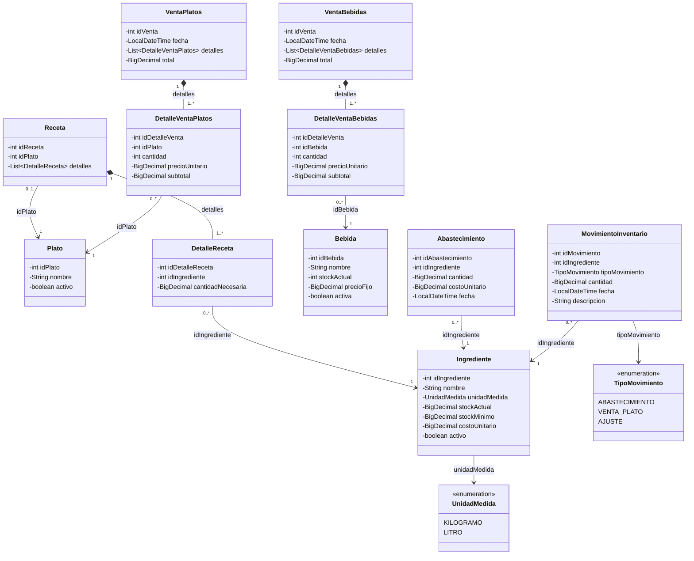

# Sistema de Gestión de Cafetería UTN

**Trabajo 1 de Bases de Datos – Universidad Técnica del Norte**  
**Ejercicio:** 4 – Sistema de Gestión de Cafetería UTN  
**Estudiante:** Sinchico Anrango Yurak Sisay  
**Rama de desarrollo:** `feature/cafeteria`  
**Repositorio grupal:** [trabajo1-bases-datos](https://github.com/MattyP200532/trabajo1-bases-datos)

Este documento describe únicamente el **Ejercicio 4: Sistema de Gestión de Cafetería UTN**. Incluye sus funcionalidades, reglas de negocio, estructura, instrucciones de ejecución, reportes, almacenamiento, diagrama de clases de los modelos, pruebas realizadas y bitácora del uso de inteligencia artificial.

---

## 1. Descripción

Sistema desarrollado en Java mediante programación orientada a objetos para administrar los ingredientes, platos, recetas, bebidas, abastecimientos, ventas y movimientos de inventario de una cafetería universitaria.

La aplicación funciona mediante un menú interactivo en consola. Permite registrar y consultar información, controlar las existencias de ingredientes y bebidas, calcular el costo de preparación de los platos, registrar ventas y consultar reportes para apoyar el control de la cafetería.

La información se almacena en archivos JSON ubicados en `data/cafeteria/`. Los datos se cargan desde esos archivos y se guardan cuando se realizan operaciones de registro o actualización.

**Responsable del ejercicio:** Sinchico Anrango Yurak Sisay.

## 2. Tecnologías utilizadas

- **Java 17:** versión de compilación configurada en el proyecto mediante Maven.
- **Apache Maven:** herramienta para compilar el proyecto, ejecutar las pruebas y lanzar la aplicación.
- **Gson 2.13.2:** biblioteca para convertir objetos Java a JSON y recuperar información desde archivos JSON.
- **JUnit Jupiter 5.11.4:** framework configurado para las pruebas automatizadas.
- **Git y GitHub:** control de versiones y almacenamiento del repositorio grupal.
- **BigDecimal:** tipo utilizado en los modelos para cantidades y valores decimales que requieren precisión.

Durante la comprobación en Windows 11 se utilizó Java 21.0.10 y Maven 3.10.0. El proyecto tiene configurados `maven.compiler.source` y `maven.compiler.target` en la versión 17.

## 3. Funcionalidades implementadas

- Registrar y listar ingredientes.
- Registrar y listar platos.
- Registrar, listar y desactivar bebidas.
- Registrar y listar recetas de los platos.
- Agregar y eliminar ingredientes de los detalles de una receta.
- Registrar y consultar abastecimientos de ingredientes.
- Aumentar el stock de ingredientes al registrar un abastecimiento.
- Registrar y consultar ventas de platos.
- Validar el inventario de ingredientes antes de registrar una venta de platos.
- Descontar del inventario las cantidades de ingredientes utilizadas en las ventas de platos.
- Registrar y consultar ventas de bebidas.
- Calcular el precio de las bebidas con IVA del 15 % y descontar su stock cuando se realiza una venta.
- Registrar y consultar movimientos de inventario de ingredientes.
- Buscar movimientos por ingrediente.
- Generar cinco reportes de cafetería.
- Guardar y recuperar la información mediante archivos JSON.

## 4. Reglas de negocio

- Los identificadores de ingredientes, platos, recetas, bebidas, abastecimientos y ventas deben ser positivos al registrar los datos.
- El nombre de un ingrediente y de una bebida es obligatorio.
- Los ingredientes utilizan las unidades de medida `KILOGRAMO` o `LITRO`.
- El stock actual, el stock mínimo y el costo unitario de un ingrediente no pueden ser negativos.
- Una receta debe tener identificadores positivos y al menos un detalle.
- Cada detalle de receta debe referenciar un ingrediente existente y tener una cantidad necesaria mayor que cero.
- Un plato no puede tener más de una receta registrada. Una receta no debe repetir el mismo ingrediente en sus detalles.
- El costo de preparación de un plato se obtiene sumando el costo unitario de cada ingrediente multiplicado por la cantidad requerida en la receta.
- El precio de venta de un plato se calcula como el doble del costo de su receta. El margen presentado por el reporte es la diferencia entre el precio y el costo.
- Para registrar un abastecimiento, el ingrediente debe existir y estar activo. La cantidad y el costo unitario deben ser mayores que cero y la fecha es obligatoria.
- Un abastecimiento aumenta el stock del ingrediente, actualiza su costo unitario y genera un movimiento de tipo `ABASTECIMIENTO`.
- Para vender platos, estos deben existir y estar activos, contar con una receta y solicitarse en cantidades mayores que cero.
- Antes de descontar ingredientes por una venta de platos, el servicio calcula el consumo total requerido y comprueba que exista stock suficiente. Si algún ingrediente no alcanza, la venta se rechaza antes de realizar los descuentos.
- Una venta de platos descuenta las cantidades definidas en las recetas y genera movimientos de tipo `VENTA_PLATO` por los ingredientes consumidos.
- Las bebidas deben tener identificador positivo, nombre, stock no negativo y precio fijo mayor que cero.
- Para vender bebidas, estas deben estar activas, tener stock suficiente y solicitarse en cantidades mayores que cero.
- El IVA aplicado a las bebidas es del **15 %**. El importe del IVA y el precio con IVA se calculan con redondeo a dos decimales.
- El reporte de ingredientes con stock bajo muestra ingredientes activos cuyo stock actual es **estrictamente menor** que el stock mínimo.
- El reporte de platos preparables calcula cuántas unidades pueden elaborarse según el ingrediente que limite la producción.
- El reporte de platos más vendidos considera las ventas cuya fecha está dentro del intervalo indicado, incluidas las fechas inicial y final.
- Los movimientos de inventario conservan el identificador del ingrediente, el tipo de movimiento, la cantidad, la fecha y la descripción.

## 5. Estructura del sistema

El código fuente de Cafetería UTN se encuentra en `src/main/java/com/trabajo1/`. La clase `com.trabajo1.App` contiene el método `main` y el menú principal.

```text
trabajo1-bases-datos/
├── pom.xml
├── README.md
├── data/
│   └── cafeteria/
│       ├── ingredientes.json
│       ├── platos.json
│       ├── recetas.json
│       ├── bebidas.json
│       ├── abastecimientos.json
│       ├── ventas_platos.json
│       ├── ventas_bebidas.json
│       └── movimientos_inventario.json
└── src/
    ├── main/
    │   └── java/
    │       └── com/trabajo1/
    │           ├── App.java
    │           └── cafeteria/
    │               ├── model/
    │               ├── repository/
    │               ├── service/
    │               └── controller/
    └── test/
        └── java/com/trabajo1/
            └── AppTest.java
```

**Descripción de los componentes:**

- `com.trabajo1.App`: inicia la aplicación y presenta el menú de consola.
- `cafeteria.model`: contiene las entidades y enumeraciones que representan los datos del sistema.
- `cafeteria.repository`: contiene los repositorios que consultan y guardan los registros en archivos JSON. `JsonDataManager` centraliza la lectura y escritura de varios archivos; `BebidaRepository` utiliza Gson directamente.
- `cafeteria.service`: contiene las validaciones y reglas de negocio para ingredientes, platos, recetas, abastecimientos, bebidas, ventas, movimientos y reportes.
- `cafeteria.controller`: recibe las opciones del usuario en consola y comunica las operaciones con los servicios.
- `src/test/java/com/trabajo1`: contiene la prueba automatizada `AppTest` configurada con JUnit Jupiter.

## 6. Instrucciones de ejecución

Se necesita un JDK 17 o superior y Apache Maven. Desde el repositorio grupal, primero se debe ingresar a la carpeta interna que contiene el `pom.xml` del proyecto.

**1. Clonar el repositorio:**

```bash
git clone https://github.com/MattyP200532/trabajo1-bases-datos.git
```

**2. Ingresar a la carpeta del proyecto Maven:**

```powershell
cd trabajo1-bases-datos/trabajo1-bases-datos
```

**3. Comprobar las versiones instaladas:**

```powershell
java -version
mvn -version
```

**4. Compilar el proyecto:**

```powershell
mvn clean compile
```

**5. Ejecutar las pruebas automatizadas:**

```powershell
mvn test
```

**6. Iniciar el menú de Cafetería UTN:**

```powershell
mvn exec:java "-Dexec.mainClass=com.trabajo1.App"
```

El menú principal presenta estas opciones:

1. Gestionar ingredientes.
2. Gestionar platos.
3. Gestionar bebidas.
4. Gestionar recetas.
5. Registrar abastecimientos.
6. Registrar ventas de platos.
7. Registrar ventas de bebidas.
8. Consultar reportes.
9. Consultar movimientos de inventario.
0. Salir.

**Importante:** ejecutar la aplicación desde la carpeta que contiene `pom.xml` permite que las rutas relativas `data/cafeteria/` apunten a los archivos JSON del proyecto. Si se inicia desde otra ubicación, el programa puede buscar los datos en una ruta diferente.

## 7. Reportes disponibles

1. **Costo, precio y margen de platos:** presenta el costo de los ingredientes de cada receta, el precio de venta calculado y el margen correspondiente. En la implementación actual, el precio es el doble del costo y el margen es precio menos costo.
2. **Ingredientes con stock bajo:** muestra los ingredientes activos cuyo stock actual es inferior al stock mínimo establecido.
3. **Platos que se pueden preparar:** calcula el número de unidades que pueden elaborarse de cada plato con el inventario actual. La cantidad disponible queda determinada por el ingrediente que se agota primero.
4. **Platos más vendidos por período:** solicita fecha inicial y final, suma las cantidades vendidas de cada plato en ese intervalo y presenta los resultados de mayor a menor.
5. **Auditoría de stock:** muestra para cada ingrediente activo su stock actual y el historial de movimientos ordenado por fecha. Los abastecimientos se presentan como entradas y los consumos por venta de platos como salidas. Este reporte presenta el historial para su revisión; no genera por sí solo una alerta automática de diferencias entre el saldo y los movimientos.

## 8. Almacenamiento de datos

El sistema utiliza ocho archivos JSON dentro de `data/cafeteria/`:

| Archivo | Información almacenada | Registros de ejemplo incorporados |
|---|---|---:|
| `ingredientes.json` | Ingredientes, unidad de medida, stock actual, stock mínimo, costo y estado. | 11 |
| `platos.json` | Identificador, nombre y estado de los platos. | 5 |
| `recetas.json` | Recetas asociadas a platos y sus detalles de ingredientes y cantidades. | 5 recetas |
| `bebidas.json` | Identificador, nombre, stock, precio fijo y estado de las bebidas. | 5 |
| `abastecimientos.json` | Ingrediente abastecido, cantidad, costo unitario y fecha. | 22 |
| `ventas_platos.json` | Fecha, detalles de platos vendidos, cantidades, precios, subtotales y total. | 5 |
| `ventas_bebidas.json` | Fecha, detalles de bebidas vendidas, cantidades, precios con IVA, subtotales y total. | 5 |
| `movimientos_inventario.json` | Entradas y salidas de ingredientes, tipo, cantidad, fecha y descripción. | 65 |

Los datos de ejemplo contienen 11 ingredientes, 5 platos, 5 recetas, 5 bebidas, 22 abastecimientos, 5 ventas de platos, 5 ventas de bebidas y 65 movimientos de inventario. Los movimientos incorporados se distribuyen en 22 registros `ABASTECIMIENTO` y 43 registros `VENTA_PLATO`.

Las fechas se manejan con `LocalDateTime` y se representan en formato ISO local, por ejemplo `2026-11-04T10:44`. Los identificadores de las relaciones se guardan como referencias numéricas; por ejemplo, `Receta.idPlato` relaciona una receta con un plato y `DetalleReceta.idIngrediente` relaciona un detalle con un ingrediente.

La persistencia se realiza en archivos locales. No se utiliza una base de datos relacional para este ejercicio.

## 9. Limitaciones del sistema

- Es una aplicación académica de consola; no dispone de una interfaz gráfica o una aplicación web.
- La persistencia utiliza archivos JSON locales y no una base de datos relacional.
- No está diseñada para que varios usuarios modifiquen los mismos archivos simultáneamente.
- La prueba automatizada incluida actualmente es básica y no cubre todas las reglas de negocio; se recomienda ampliar las pruebas unitarias para ventas, abastecimientos, validaciones de stock y reportes.
- El reporte denominado `Auditoría de stock` presenta el stock actual y el historial de movimientos ordenado por fecha, pero no compara automáticamente el saldo calculado con el saldo almacenado ni genera alertas de inconsistencias.
- El historial `movimientos_inventario.json` registra movimientos de ingredientes por abastecimientos y ventas de platos. Las ventas de bebidas actualizan el stock de bebidas, pero no se incorporan a ese historial de movimientos de ingredientes.
- Los datos cargados son registros de ejemplo para pruebas académicas; no representan operaciones reales de una cafetería.

## 10. Responsable y repositorio

**Estudiante responsable:** Sinchico Anrango Yurak Sisay  
**Ejercicio:** 4 – Sistema de Gestión de Cafetería UTN  
**Universidad:** Universidad Técnica del Norte (UTN)  
**Rama de trabajo:** `feature/cafeteria`  
**Repositorio:** [https://github.com/MattyP200532/trabajo1-bases-datos](https://github.com/MattyP200532/trabajo1-bases-datos)

Commits registrados en la rama para los datos y la documentación de este ejercicio:

- `e126086` – `Completar datos iniciales de Cafeteria UTN`.
- `0352a7d` – `Documentacion ejercicio 4 Cafeteria UTN`.

## 11. Diagrama de clases UML – Modelos

El siguiente diagrama representa **únicamente las clases y enumeraciones del paquete `com.trabajo1.cafeteria.model`**. No incluye controladores, servicios, repositorios ni la clase principal de la aplicación. Las asociaciones se representan mediante los identificadores que almacenan los modelos.



## 12. Pruebas y resultados del testeo

Se realizó una comprobación manual del menú de Cafetería UTN utilizando la aplicación ejecutada desde Maven. Se consultaron los ocho módulos de datos y se ejecutaron los cinco reportes con los registros JSON de ejemplo.

También se ejecutó `mvn test`. El resultado observado fue:

```text
Tests run: 1, Failures: 0, Errors: 0, Skipped: 0
BUILD SUCCESS
```

**Alcance de la prueba automatizada:** la única clase de prueba encontrada en `src/test/java/com/trabajo1/AppTest.java` contiene el método `shouldAnswerWithTrue()` y comprueba `assertTrue(true)`. Por tanto, el resultado confirma que JUnit se ejecutó sin fallos, pero no constituye una prueba automatizada de las reglas de negocio de la cafetería. Las comprobaciones funcionales descritas a continuación fueron realizadas manualmente desde el menú de consola.

## 13. Tabla de casos de prueba con resultados

Los siguientes resultados corresponden a las ejecuciones observadas durante la comprobación del proyecto en Windows 11, Java 21.0.10 y Maven 3.10.0.

| ID | Caso de prueba | Procedimiento | Resultado esperado | Resultado obtenido | Estado |
|---|---|---|---|---|---|
| CP-01 | Ejecución de pruebas JUnit | Ejecutar `mvn test`. | Ejecutar las pruebas sin errores. | 1 prueba ejecutada; 0 fallos, 0 errores y 0 omitidas. `BUILD SUCCESS`. | Correcto |
| CP-02 | Inicio de la aplicación | Ejecutar `mvn exec:java "-Dexec.mainClass=com.trabajo1.App"`. | Mostrar el menú principal de Cafetería UTN. | El menú apareció y la aplicación finalizó con `BUILD SUCCESS` al seleccionar salir. | Correcto |
| CP-03 | Listado de ingredientes | Menú 1 → opción 2. | Mostrar los ingredientes registrados. | Se visualizaron 11 ingredientes con unidad, stock, stock mínimo, costo y estado. | Correcto |
| CP-04 | Listado de platos | Menú 2 → opción 2. | Mostrar los platos registrados. | Se visualizaron 5 platos activos: Chaulafán, Arroz con pollo, Bolón de verde con queso, Tigrillo y Seco de pollo. | Correcto |
| CP-05 | Listado de bebidas | Menú 3 → opción 2. | Mostrar las bebidas, stock, precios y estado. | Se visualizaron 5 bebidas. Se mostró Coca Cola inactiva y el precio con IVA del 15 % para las bebidas. | Correcto |
| CP-06 | Listado de recetas | Menú 4 → opción 2. | Mostrar las recetas y sus ingredientes. | Se visualizaron 5 recetas relacionadas con los platos mediante `idPlato`; sus detalles mostraron ingredientes y cantidades. | Correcto |
| CP-07 | Listado de abastecimientos | Menú 5 → opción 2. | Mostrar los abastecimientos registrados. | Se visualizaron 22 registros con ingrediente, cantidad, costo unitario y fecha. | Correcto |
| CP-08 | Historial de ventas de platos | Menú 6 → opción 2. | Mostrar las ventas, detalles, subtotales y totales. | Se visualizaron 5 ventas. Los totales mostrados fueron $28,00; $16,66; $24,90; $22,52 y $9,00. | Correcto |
| CP-09 | Historial de ventas de bebidas | Menú 7 → opción 2. | Mostrar las ventas y precios con IVA. | Se visualizaron 5 ventas. Los totales fueron $11,67; $6,82; $11,64; $13,27 y $8,88. | Correcto |
| CP-10 | Historial de movimientos | Menú 9 → opción 1. | Mostrar los movimientos de inventario. | Se visualizaron 65 movimientos: 22 `ABASTECIMIENTO` y 43 `VENTA_PLATO`. | Correcto |
| CP-11 | Reporte de costo, precio y margen | Menú 8 → opción 1. | Calcular costo, precio y margen para los platos activos. | Chaulafán: $1,050 / $2,100 / $1,050; Arroz con pollo: $1,120 / $2,240 / $1,120; Bolón: $0,710 / $1,420 / $0,710; Tigrillo: $0,840 / $1,680 / $0,840; Seco de pollo: $1,200 / $2,400 / $1,200. | Correcto |
| CP-12 | Reporte de ingredientes con stock bajo | Menú 8 → opción 2. | Mostrar ingredientes activos con stock menor al mínimo. | Se mostraron Huevo (0,3 / 0,5), Cebolla paiteña (0,4 / 0,5), Aceite vegetal (0,9 / 1), Salsa de soya (0,2 / 0,25) y Queso fresco (0,35 / 0,5), en el orden stock actual / stock mínimo. | Correcto |
| CP-13 | Reporte de platos preparables | Menú 8 → opción 3. | Calcular las unidades posibles según el inventario. | Chaulafán: 7; Arroz con pollo: 13; Bolón: 5; Tigrillo: 3; Seco de pollo: 13. | Correcto |
| CP-14 | Reporte de platos más vendidos | Menú 8 → opción 4; período `2026-10-27T00:00` a `2026-11-04T23:59`. | Sumar las cantidades vendidas dentro del período y ordenar de mayor a menor. | Chaulafán: 15; Bolón: 13; Arroz con pollo: 9; Seco de pollo: 8; Tigrillo: 7. | Correcto |
| CP-15 | Reporte de auditoría de stock | Menú 8 → opción 5. | Mostrar el stock actual y el historial de movimientos de cada ingrediente activo. | Se visualizaron stocks e historiales ordenados por fecha. Se revisaron manualmente, entre otros, los saldos de salsa de soya, plátano verde, queso fresco y tomate riñón; las operaciones de esos ejemplos coincidieron con el stock mostrado. | Correcto |

**Nota sobre el alcance:** los casos anteriores documentan las consultas y reportes ejecutados. No se afirma que se hayan probado manualmente todos los escenarios de error, como una venta rechazada por stock insuficiente, identificadores duplicados o fechas incorrectas. Esos escenarios pueden añadirse como pruebas adicionales.

## 14. Bitácora del uso de inteligencia artificial

Se utilizó una herramienta de inteligencia artificial como apoyo durante el desarrollo y documentación del Ejercicio 4. Su uso se registró de forma transparente y las propuestas se revisaron antes de incorporarlas al proyecto.

| Actividad | Apoyo recibido de IA | Trabajo realizado y verificado por el estudiante |
|---|---|---|
| Revisión inicial del proyecto | Orientación para identificar los modelos, repositorios, servicios, controladores y el funcionamiento de `JsonDataManager`. | Se revisó el proyecto Java y se contrastaron los nombres y tipos de atributos con los archivos JSON. |
| Preparación de datos de ejemplo | Apoyo para proponer registros variados y relaciones coherentes para los ocho archivos JSON. | Se incorporaron los archivos a `data/cafeteria/` y se consultaron desde los menús de la aplicación. |
| Coherencia de inventario y ventas | Ayuda para revisar cantidades de recetas, abastecimientos, consumos, stocks, subtotales y totales. | Se ejecutó el sistema y se compararon los resultados mostrados con los datos preparados. |
| Uso de herramientas de desarrollo | Explicaciones para ejecutar Maven, interpretar resultados y utilizar comandos básicos de Git. | El estudiante ejecutó `mvn test`, inició la aplicación, realizó las consultas manuales y registró los commits en la rama `feature/cafeteria`. |
| Documentación | Apoyo para organizar y redactar el README, la tabla de pruebas y el diagrama UML de modelos. | El estudiante revisó la documentación y comprobó que las clases y atributos del diagrama correspondieran al paquete `model`. |

**Declaración de uso:** la inteligencia artificial se utilizó como herramienta de apoyo para analizar, organizar, proponer datos de prueba y redactar documentación. La revisión, incorporación de archivos, ejecución de comandos, comprobación manual de resultados y responsabilidad sobre la entrega correspondieron al estudiante. La presente bitácora debe considerarse junto con las indicaciones específicas del compromiso 7 del sílabo.

## 15. Entregables y evidencias del Trabajo 1

Para el Ejercicio 4 se documentan los siguientes elementos:

1. **Repositorio GitHub:** [trabajo1-bases-datos](https://github.com/MattyP200532/trabajo1-bases-datos).
2. **Rama de trabajo:** `feature/cafeteria`, donde se registraron los cambios del ejercicio.
3. **Datos JSON de ejemplo:** los ocho archivos de `data/cafeteria/`, con registros para ingredientes, platos, recetas, bebidas, abastecimientos, ventas y movimientos.
4. **README del ejercicio:** este documento, con instrucciones, reglas, reportes, diagrama UML de modelos, pruebas y bitácora de IA.
5. **Tabla de casos de prueba:** incluida en la sección 13, con los resultados observados durante las pruebas manuales y automatizadas.
6. **Informe PDF para el portafolio académico:** debe prepararse con el nombre solicitado por la asignatura, `Apellidos-Tr1.pdf`, e incluir la evidencia del trabajo. Para este ejercicio, el apellido del estudiante es Sinchico Anrango.

**Commits relacionados con los cambios de Cafetería registrados en la rama:**

- `e126086` – Completar datos iniciales de Cafeteria UTN.
- `0352a7d` – Documentacion ejercicio 4 Cafeteria UTN.

---

**Autor:** Sinchico Anrango Yurak Sisay  
**Universidad Técnica del Norte – Trabajo 1 de Bases de Datos**
