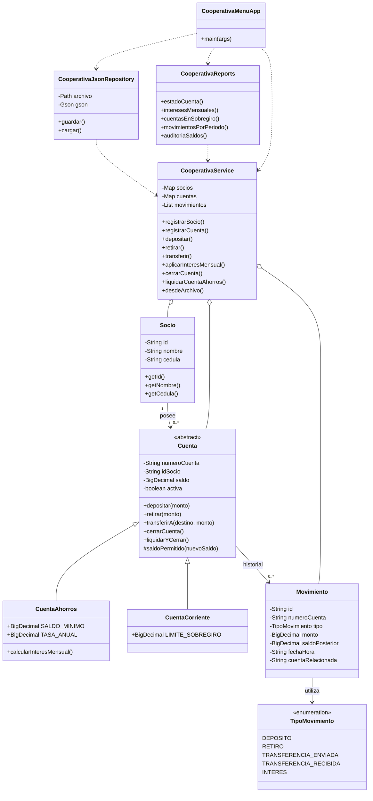

# Sistema de Cooperativa de Ahorro y Crédito

## 1. Descripción

Sistema desarrollado en Java mediante programación orientada
a objetos, que permite administrar socios, cuentas de ahorro,
cuentas corrientes y operaciones financieras.

La información se almacena en archivos JSON.

## 2. Tecnologías utilizadas

- Java 17 como versión de compilación
- Maven
- Gson
- JUnit 4
- Git y GitHub

## 3. Funcionalidades

- Registro de socios.
- Creación de cuentas de ahorro y corrientes.
- Depósitos y retiros.
- Transferencias entre cuentas.
- Cálculo y acreditación de intereses mensuales.
- Control de sobregiros.
- Cierre y liquidación de cuentas.
- Registro de movimientos financieros.
- Persistencia mediante JSON.
- Generación de reportes administrativos.

## 4. Reglas de negocio

- Las cuentas de ahorro generan un interés anual del 4 %.
- Las cuentas de ahorro mantienen un saldo mínimo de $5.
- Las cuentas corrientes permiten sobregiros de hasta $200.
- Los depósitos y retiros deben ser mayores que cero.
- No se permiten transferencias entre la misma cuenta.
- Las cuentas inactivas no permiten operaciones normales.
- Las cuentas solo se cierran con saldo cero.
- Los movimientos se conservan para auditoría.

## 5. Estructura del sistema

- model: entidades y clases bancarias.
- service: reglas de negocio y operaciones financieras.
- repository: almacenamiento y recuperación JSON.
- reports: reportes y auditoría.
- app: menú interactivo y aplicaciones de prueba.

## 6. Ejecución

Desde la carpeta que contiene pom.xml:

Compilar:

    mvn clean compile

Ejecutar pruebas:

    mvn clean test

Iniciar el menú:

    mvn exec:java "-Dexec.mainClass=com.trabajo1.cooperativa.app.CooperativaMenuApp"

## 7. Reportes disponibles

1. Estado de cuenta con saldos posteriores.
2. Intereses mensuales acreditados.
3. Cuentas corrientes en sobregiro.
4. Depósitos y retiros durante un período.
5. Auditoría de saldos.

## 8. Pruebas

Se implementaron pruebas con JUnit para verificar
depósitos, retiros, transferencias, saldo mínimo,
sobregiros, cierre de cuentas, intereses y persistencia JSON.

Los resultados reales deben verificarse ejecutando
mvn clean test.

## 9. Almacenamiento

El archivo data/cooperativa/estado.json conserva
socios, cuentas y movimientos.

El sistema recupera estos datos al iniciarse y guarda
el estado después de las operaciones válidas.

## 10. Limitaciones

El sistema es una implementación académica.

No está preparado para operaciones bancarias reales.
Se requiere reforzar la atomicidad duradera de las
transferencias, la recuperación ante fallos de escritura
y la validación integral de los importes monetarios.

## 11. Diagrama de clases UML

