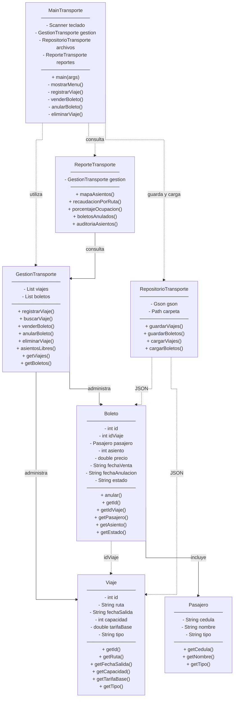

# Sistema de Cooperativa de Transporte

## 1. Descripción

Sistema desarrollado en Java mediante programación orientada a objetos para administrar viajes, pasajeros y boletos de una cooperativa de transporte. Permite registrar rutas y horarios, vender y anular boletos, controlar los asientos disponibles y generar reportes.

La información se guarda en archivos JSON y se recupera al volver a iniciar el programa.

## 2. Tecnologías utilizadas

- Java 17 como versión de compilación.
- Maven para organizar, compilar y ejecutar el proyecto.
- Gson para guardar y recuperar información en JSON.
- JUnit 4 para las pruebas automatizadas.
- Git y GitHub para el control de versiones.

## 3. Funcionalidades

- Registro y consulta de viajes.
- Venta de boletos con asignación de asientos.
- Anulación de boletos y liberación de asientos.
- Consulta de los boletos registrados y su estado.
- Eliminación de viajes sin boletos vendidos.
- Cálculo de tarifas y descuentos según el tipo de viaje y pasajero.
- Consulta de asientos libres y mapa de ocupación.
- Generación de cinco reportes de transporte.
- Almacenamiento y recuperación de viajes y boletos mediante JSON.

## 4. Reglas de negocio

- Se admiten las rutas Ibarra-Quito, Ibarra-Tulcan e Ibarra-Otavalo.
- Los viajes pueden ser `DIRECTO` o `CON_PARADAS`.
- En viajes `CON_PARADAS` se cobra el 85 % de la tarifa base.
- Los pasajeros de tipo `TERCERA_EDAD` y `DISCAPACIDAD` reciben un descuento del 50 % sobre el precio del viaje; los de tipo `NORMAL` pagan el precio correspondiente sin ese descuento.
- No se pueden registrar dos viajes con el mismo ID.
- La capacidad y la tarifa base deben ser mayores que cero.
- No se permite vender dos boletos activos para el mismo asiento de un viaje.
- No se permite vender boletos cuando el viaje ya salió ni asignar asientos fuera de la capacidad del vehículo.
- Un boleto solo puede anularse hasta dos horas antes de la salida; no se permite anularlo dos veces.
- Los boletos anulados se conservan para el historial y liberan su asiento.
- No se permite eliminar un viaje que tenga boletos registrados, sean activos o anulados.

## 5. Estructura del sistema

- `model`: contiene las entidades `Viaje`, `Pasajero` y `Boleto`.
- `service`: contiene `GestionTransporte`, con las validaciones y las operaciones del sistema.
- `repository`: contiene `RepositorioTransporte`, encargado de guardar y recuperar los archivos JSON.
- `reports`: contiene `ReporteTransporte`, que genera los reportes y la auditoría.
- `app`: contiene `MainTransporte`, el menú interactivo en consola.
- `src/test/java/com/trabajo1/Transporte1`: contiene las pruebas automatizadas de horarios y auditoría.

## 6. Ejecución

Se necesita tener instalado Java y Maven. Desde la carpeta que contiene `pom.xml`:

**Compilar:**

```powershell
mvn compile
```

**Ejecutar todas las pruebas:**

```powershell
mvn test
```

**Iniciar el menú de transporte:**

```powershell
mvn compile exec:java "-Dexec.mainClass=com.trabajo1.transporte.app.MainTransporte"
```

Para ejecutar una prueba específica en PowerShell:

```powershell
mvn "-Dtest=HorarioTransporteTest" test
mvn "-Dtest=AuditoriaTransporteTest" test
```

En el menú se seleccionan opciones del 1 al 11 para realizar operaciones o consultar reportes, y la opción `0` para salir.

**Importante:** ejecutar desde la carpeta que contiene `pom.xml` permite que los archivos se guarden en la ruta `data/transporte` correcta.

## 7. Reportes disponibles

1. **Mapa de asientos:** muestra qué asientos están ocupados y cuáles permanecen libres en un viaje.
2. **Recaudación por ruta:** suma el valor de los boletos activos vendidos dentro de un período, separado por ruta.
3. **Porcentaje de ocupación:** calcula el porcentaje de asientos ocupados de cada viaje.
4. **Boletos anulados:** presenta las anulaciones realizadas durante las fechas indicadas.
5. **Auditoría de asientos:** revisa la consistencia de los asientos, detectando posibles duplicados, asientos inválidos o boletos sin viaje.

## 8. Pruebas

Se realizaron pruebas manuales de registro de viajes, venta de boletos, descuentos, ocupación de asientos, anulaciones, eliminación de viajes, generación de reportes y recuperación de datos JSON.

También se añadieron dos clases de pruebas con JUnit:

- `HorarioTransporteTest`: comprueba que la anulación se rechaza si falta una hora para la salida y se permite cuando faltan tres horas.
- `AuditoriaTransporteTest`: comprueba que el sistema marca como `REVISAR` una inconsistencia simulada con dos boletos activos para el mismo asiento.

**Resultado observado durante las pruebas del proyecto:**

```text
Tests run: 4, Failures: 0, Errors: 0, Skipped: 0
BUILD SUCCESS
```

Este resultado corresponde a la ejecución realizada durante el desarrollo; se puede repetir con `mvn test`.

## 9. Almacenamiento

El sistema utiliza dos archivos dentro de `data/transporte/`:

- `viajes.json`: guarda el ID, la ruta, la fecha de salida, la capacidad, la tarifa base y el tipo de cada viaje.
- `boletos.json`: guarda los datos del boleto y del pasajero, el asiento, el precio, las fechas de venta y anulación, y el estado del boleto.

Los datos se cargan al iniciar el menú y se vuelven a guardar después de registrar o eliminar viajes y después de vender o anular boletos.


## 10. Limitaciones

Este proyecto es una implementación académica que funciona mediante consola y archivos JSON; no utiliza una base de datos relacional ni está preparado para varias personas vendiendo boletos al mismo tiempo.

Los datos de pasajeros se ingresan manualmente, sin verificar documentos reales, y las cantidades monetarias se manejan con `double`. Para un sistema de uso real sería necesario reforzar las validaciones, la seguridad de los datos, el control de acceso, las ventas simultáneas y la protección frente a fallos de escritura.


## 11. Diagrama de clases UML


